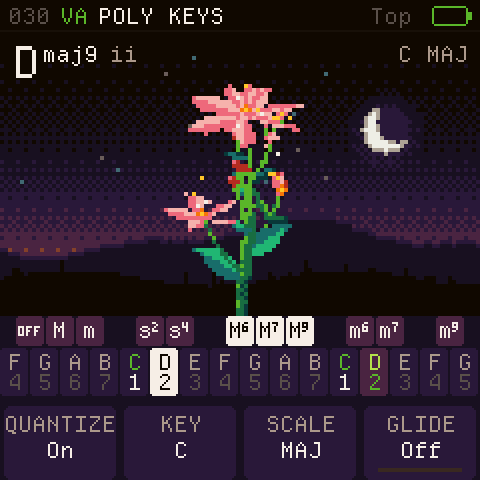
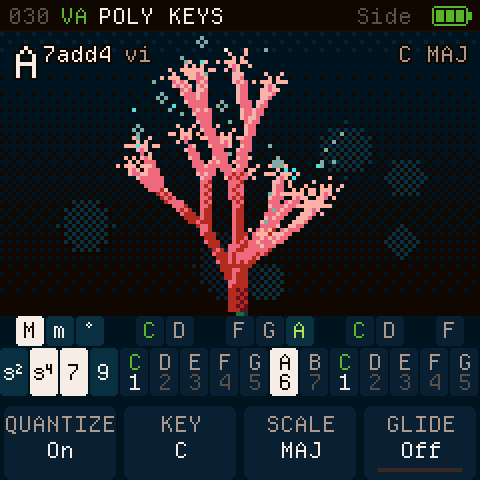
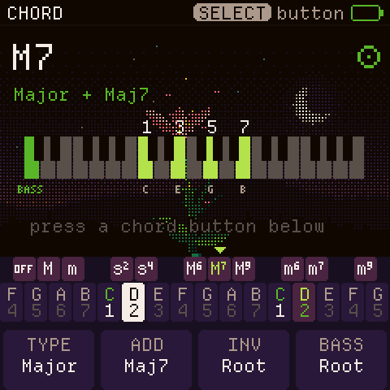
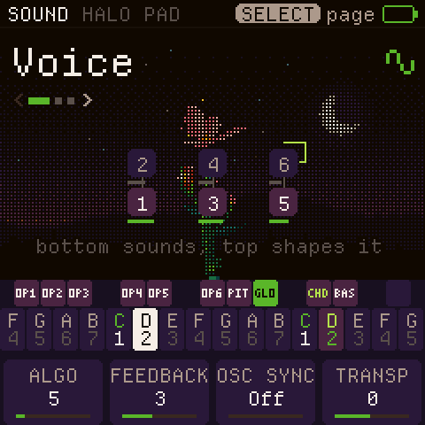
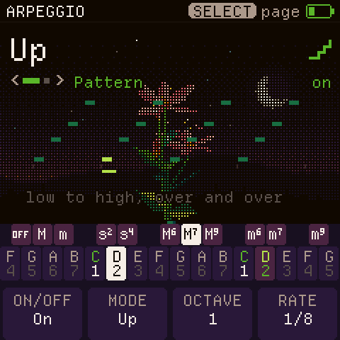
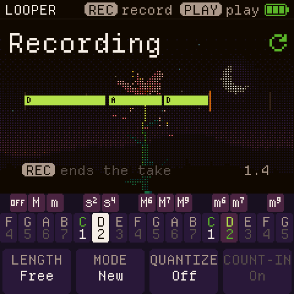

# CoralFlower

**Your M-VAVE FM-1, made for chords.** CoralFlower is free firmware for the FM-1. Press one key, and it plays a whole
chord that fits the scale you chose, with a bass underneath. While you play, a pixel flower grows from your chords.

CoralFlower is inspired by the Telepathic Instruments Orchid. Its controls are redesigned for the FM-1's keys and
buttons, because every instrument is played differently.

  <a href="https://ficusficusov.github.io/CoralFlower/play/"><b>Play it in your browser</b></a> ·
  <a href="https://ficusficusov.github.io/CoralFlower/"><b>Install it on your FM-1</b></a> ·
  <a href="https://github.com/FicusFicusov/CoralFlower/releases"><b>Releases</b></a>

Not sure yet? The browser version runs the same firmware with sound. Try it with your mouse or computer keyboard
before you install anything.

## What it does

- **One key, one chord.** The lower keys play the chords of your scale: in C major, A plays A minor and B plays
  B diminished. Hold an upper key to change the chord to major, minor, sus2, sus4, 6, 7 or 9, or hold two to combine
  them. Choose from 26 scales, starting on any note. Chord glide (off by default) slides each note into the next chord.
- **Two layouts, each with a Lock mode.** In the Top layout, the upper row picks the chord type and the lower row the
  root. In the Side layout, a few keys on the left pick the type and the rest play roots. Lock mode keeps the chord
  type you tapped, so you don't have to hold its key.
- **A bass part under your chords** (you can turn it off), with its own sound and range, plus an octaver that doubles each bass note.
- **An arpeggiator** with nine patterns, including a strum like the one on the Orchid chord synth. It locks to the
  metronome or to an external MIDI clock.
- **A looper for chord progressions,** with count-in, overdub, undo and timing correction. Save the loop, and it
  stays after you switch off.
- **Six effects** in an order you choose: filter, drive, chorus, phaser, delay and reverb.
- **About 60 sounds** from two synth engines, virtual analogue and FM: pads, keys, strings and basses. Many pads
  change slowly on their own. Chords and basses have separate lists. Every sound has an editor, and you can save your
  own.
- **A plant that grows from your music.** In the Top key layout a flower grows; in the Side layout, a coral.
  Each note of the chord adds a part: a bloom, a bud, a cluster of berries. The plant's structure follows
  [PlantStudio](https://github.com/pdfernhout/PlantStudio), a program that models real plants.
- **MIDI over USB.** Chord and bass notes go out on their own channels, and a MIDI clock comes in.

<table>
  <tr>
    <td></td>
    <td></td>
    <td></td>
  </tr>
  <tr>
    <td></td>
    <td></td>
    <td></td>
  </tr>
</table>

## Install

1. Open <https://ficusficusov.github.io/CoralFlower/> in **Chrome or Edge** on a computer. Only these browsers can talk
   to the FM-1 over USB.
2. Connect the FM-1 straight to the computer. Don't use a USB hub, and use a cable that carries data, not a
   charge-only one.
3. Press **Install on your FM-1**. Keep the page open and the cable in for about a minute. The FM-1 restarts as
   CoralFlower.

If the FM-1 runs CoralFlower, ChoralRoot or Felucca, the installer saves your sounds to a file first. The official firmware's sounds can't be backed up. To return to the stock firmware, download FM-1
V15 from [m-vave.com](https://www.m-vave.com) and install it from the same CoralFlower page. Installing firmware is at
your own risk.

## Build it yourself

- **The emulator and the site.** Install the [Emscripten SDK](https://emscripten.org), then run
  `sh tools/emu/web/build_web.sh` and `sh tools/make_site.sh build/site`. The site lands in `build/site/`, with the
  emulator in `build/site/play/`.
- **The headless runner.** `sh tools/emu/cf_headless.sh SCRIPT` plays a script of key presses, takes screenshots and
  records audio. The tests use it.
- **The firmware package.** `./build.sh --release X.Y` needs the toolchain from JieLi, the maker of the FM-1's chip.
  The toolchain runs on Linux x86-64 only, and `tools/get_toolchain.sh` fetches it. On GitHub, the release workflow
  (`.github/workflows/release.yml`) builds the package for you.

## Credits and licence

CoralFlower is a fork of [ChoralRoot FM-1](https://github.com/Quixotic7/ChoralRootFM1) by Quixotic7, which is itself
a fork of [Felucca](https://github.com/hugelton/Felucca) by Leo Kuroshita (Hügelton Instruments). The FM engine comes
from [Melodee](https://github.com/keremimo/melodee) by Kerem Kilic, and the screens use
[Departure Mono](https://departuremono.com), a font by Helena Zhang. Thank you all.

CoralFlower is free software under the GPL-3.0. `LICENSE` and `LICENSING.md` have the details.

M-VAVE and FM-1 are trademarks of their respective owners. Orchid is a product of Telepathic Instruments. CoralFlower
is not affiliated with M-VAVE, Cuvave or Telepathic Instruments.

## Feedback and support

CoralFlower is new, and your feedback decides what comes next. Tell me what feels good, what feels off, and which
sounds or features you want:

- open a [GitHub issue](https://github.com/FicusFicusov/CoralFlower/issues);
- email me at iambemoli@gmail.com;
- follow the news in the Telegram channel [t.me/ficusficusov](https://t.me/ficusficusov).

CoralFlower has no ads and no paid version. To support it, press **Support** on
[the site](https://ficusficusov.github.io/CoralFlower/): it lists crypto wallets.
